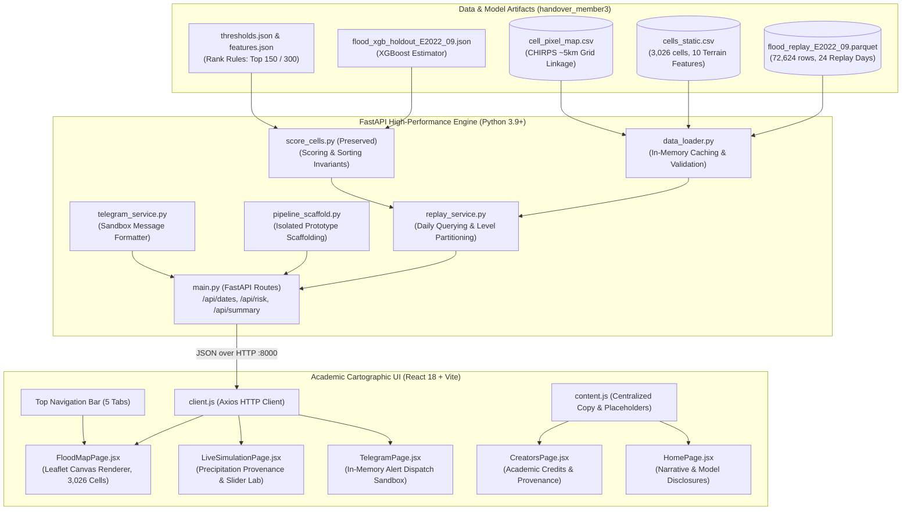
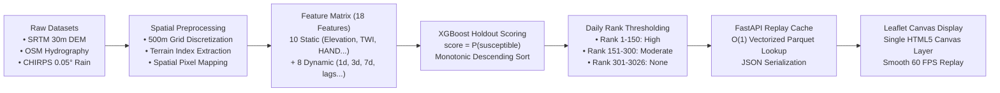

# N²M Flood Prediction Model

**An Explainable Machine Learning Framework for High-Resolution Urban Flood Susceptibility Mapping & Historical Replay in Greater Bengaluru**

[](https://fastapi.tiangolo.com/)
[](https://reactjs.org/)
[](https://leafletjs.com/)
[](https://xgboost.readthedocs.io/)
[]()
[]()

---

> ### ⚠️ Critical Scientific & Civic Disclaimer
> **The N²M Flood Prediction Model is an empirical academic research prototype and NOT a certified municipal early warning or civic emergency alert system.**
>
> 1. **Relative Spatial Susceptibility**: Model outputs represent relative daily spatial prioritization across cells, **NOT** calibrated probabilities of flood occurrence, physical inundation depths, or flood plain boundaries.
> 2. **No Hydrodynamic Simulation**: The model evaluates cell-level static terrain vulnerability and dynamic rainfall saturation; it does not solve 1D/2D Saint-Venant shallow water equations or simulate pipe network backflow.
> 3. **Non-Operational**: This platform must never be used for life-safety directives, real-time public evacuations, or municipal operational dispatch.

---

## Dedicated Technical Documentation

In addition to this README, deep-dive specifications are available in the [`docs/`](docs/) directory:
* 📐 **[System Architecture & Diagrams (`docs/ARCHITECTURE.md`)](docs/ARCHITECTURE.md)**: Three Mermaid diagrams (System Architecture, Data Flow, Replay Workflow), component boundaries, and high-FPS Canvas rendering mechanics.
* 🧠 **[Model Methodology & Scientific Validation (`docs/MODEL_METHODOLOGY.md`)](docs/MODEL_METHODOLOGY.md)**: XGBoost formulation, exact 18 feature descriptions, scale_pos_weight calibration, PR-AUC holdout metrics, and scientific boundaries.
* 🔌 **[REST API Documentation (`docs/API_DOCUMENTATION.md`)](docs/API_DOCUMENTATION.md)**: Exhaustive endpoint reference, query parameters, error codes, and real JSON response schemas.

---

## Table of Contents

1. [Project Overview](#1-project-overview)
2. [Problem Statement](#2-problem-statement)
3. [Objectives & Project Scope](#3-objectives--project-scope)
4. [System Architecture](#4-system-architecture)
5. [Data Flow Pipeline](#5-data-flow-pipeline)
6. [Machine Learning Model](#6-machine-learning-model)
7. [Dataset Description](#7-dataset-description)
8. [Feature Engineering & Definitions](#8-feature-engineering--definitions)
9. [Historical Replay Methodology (September 2022 Holdout)](#9-historical-replay-methodology-september-2022-holdout)
10. [Relative Susceptibility Ranking Methodology](#10-relative-susceptibility-ranking-methodology)
11. [Model Performance & Empirical Validation](#11-model-performance--empirical-validation)
12. [Known Limitations & Scientific Boundaries](#12-known-limitations--scientific-boundaries)
13. [Backend Setup & Installation](#13-backend-setup--installation)
14. [Frontend Setup & Installation](#14-frontend-setup--installation)
15. [Complete API Route Documentation](#15-complete-api-route-documentation)
16. [Repository Structure](#16-repository-structure)
17. [Frontend Feature & Navigation Guide](#17-frontend-feature--navigation-guide)
18. [Simulation & Live Scaffolding Details](#18-simulation--live-scaffolding-details)
19. [Telegram Demonstration Bot Integration](#19-telegram-demonstration-bot-integration)
20. [Academic Maintainers, Credits & Citations](#20-academic-maintainers-credits--citations)
21. [Cloud Deployment Guide (Render & Vercel)](#21-cloud-deployment-guide-render--vercel)

---

## 1. Project Overview

The **N²M Flood Prediction Model** is an academic geospatial data science project developed for Greater Bengaluru, Karnataka, India. The project models how extreme monsoonal precipitation interacts with the city's complex undulating topography and rapidly expanding built environment.

By discretizing Bengaluru into a contiguous mesh of **3,026 spatial cells** (~500m × 500m resolution), the system combines 10 high-resolution static terrain morphology indices with 8 dynamic precipitation saturation metrics. A trained gradient-boosted decision tree ensemble (**XGBoost**) scores each cell daily, establishing a relative spatial susceptibility ranking:
- **High Susceptibility (Tier 1)**: Top 150 ranked cells (~5% of urban area).
- **Moderate Susceptibility (Tier 2)**: Next 150 ranked cells (ranks 151–300, ~5% of urban area).
- **Baseline Susceptibility (Tier 3)**: Remaining 2,726 cells (~90% of urban area).

The platform couples an asynchronous **FastAPI** backend with a custom, cartography-inspired **React + Leaflet** research interface. It provides interactive historical replay across 24 consecutive days of the devastating **September 2022 monsoon flood event (E2022_09)**.

---

## 2. Problem Statement

Bengaluru sits on an elevated ridge in the Deccan Plateau (approx. 900–960 m above mean sea level), partitioned across three primary drainage valleys: the **Hebbal Valley**, the **Vrishabhavathi Valley**, and the **Koramangala–Challaghatta (KC) Valley**. Historically, the region relied on an interconnected network of hundreds of man-made irrigation tanks (*keres*) linked by primary stormwater channels (*rajakaluves*).

Over the past four decades, rapid and uncontrolled urbanization has disrupted this delicate hydrology:
- **Impervious Surface Explosion**: Built-up land cover expanded from under 8% in 1973 to over 93% in 2020.
- **Valley & Wetland Encroachment**: Natural overflow pathways and lake beds have been paved over for arterial highways and IT tech parks, particularly in the eastern IT corridor (Bellandur, Mahadevapura, Whitefield).
- **Localized Cloudbursts**: Tropical convective storm cells frequently drop 70–120 mm of rain within 60–90 minutes over isolated sectors of the city while leaving adjacent taluks dry.
- **Coarse Alerts**: Existing civic alerts are generalized at the municipal (BBMP) or district scale, providing zero actionable spatial differentiation for micro-catchments, underpasses, and low-lying valleys.

---

## 3. Objectives & Project Scope

### Primary Objectives
1. **Micro-Scale Spatial Prioritization**: Partition Greater Bengaluru into 3,026 discrete grid units (~500 m) to detect micro-topographical vulnerabilities.
2. **Coupled Hydrological Modeling**: Integrate static digital elevation model (DEM) derivatives (slope, Topographic Wetness Index, Height Above Nearest Drainage) with dynamic antecedent precipitation matrices (1-day to 30-day accumulation windows).
3. **Rigorous Holdout Replay**: Validate predictive stability during the benchmark 24-day September 2022 monsoon event using an unbiased holdout model (`flood_xgb_holdout_E2022_09.json`).
4. **Reproducible Academic Interface**: Deliver a zero-API-key, cartography-inspired research dashboard enabling researcher exploration, date stepper replay, cell telemetry inspection, and manual sensitivity testing.

### Project Scope Boundaries
- **In-Scope**: Historical replay evaluation, static terrain parameterization, rank-based tier classification, in-memory FastAPI serving, Leaflet Canvas rendering, empirical sensitivity lab.
- **Out-of-Scope**: Real-time civic early warning broadcasts, 2D hydrodynamic fluid velocity modeling, subsurface stormwater pipe network simulation, automated emergency siren dispatch.

---

## 4. System Architecture

The N²M architecture follows a decoupled, three-tier model ensuring mathematical reproducibility, low latency, and zero dependency on commercial mapping keys:



---

## 5. Data Flow Pipeline

The end-to-end data pipeline transforms raw spaceborne observations into daily interactive cartographic visualizations:



1. **Topographic Derivation**: 30-meter NASA SRTM DEM tiles are hydrologically conditioned to remove spurious pits. Terrain derivatives (slope, flow accumulation, TWI, HAND) are extracted and aggregated to cell centroids.
2. **Hydrographic Vectors**: OpenStreetMap stormwater drainage vectors (*rajakaluves*) and lake waterbodies (*keres*) are indexed using spatial trees (`scipy.spatial.cKDTree`) to compute proximity metrics.
3. **Rainfall Matrix Construction**: Daily quasi-global CHIRPS precipitation grids (~5.3 km resolution) are spatially intersected with cell centroids using `cell_pixel_map.csv`. Cumulative rolling sums (3d, 7d, 14d, 30d) and preceding lags (lag1, lag2, lag3) are computed.
4. **Model Inference**: For any given replay date, the pre-computed or on-demand feature vector is evaluated by the sequestered XGBoost model (`flood_xgb_holdout_E2022_09.json`).
5. **Rank Thresholding**: Cells are sorted in strictly descending order of score. The top 150 are assigned `High`, the subsequent 150 `Moderate`, and the remainder `None`.
6. **Canvas Vector Rendering**: Rather than mounting 3,026 DOM SVG elements (which degrades browser frame rates), the frontend uses Leaflet's `preferCanvas: true` renderer, drawing all cells into a single GPU-accelerated HTML5 `<canvas>` buffer.

---

## 6. Machine Learning Model

The core predictive engine is an explainable gradient-boosted decision tree classifier trained via the **XGBoost** library.

- **Estimator Objective**: `binary:logistic`
- **Active Holdout Model**: `handover_member3/flood_xgb_holdout_E2022_09.json`
- **Full Model Artifact**: `handover_member3/flood_xgb.json`
- **Class Imbalance Strategy**: Scaled positive weighting (`scale_pos_weight`) to penalize false negatives in severely imbalanced positive ground-truth sets.
- **Tree Depth & Regularization**: Shallow tree depth ($max\_depth \approx 4$) with minimum child weights to prevent overfitting to isolated historical flood reports.
- **Holdout Sequestering**: The model `flood_xgb_holdout_E2022_09.json` was strictly trained on historical monsoon events *excluding* September 2022, ensuring zero data leakage during evaluation.

---

## 7. Dataset Description

The repository relies on structured GIS and tabular artifacts located in `handover_member3/`:

| File Name | Format | Dimensions | Description |
|:---|:---:|:---:|:---|
| `cells_static.csv` | CSV | 3,026 rows × 14 cols | Spatial index of all 3,026 Bengaluru cells. Contains cell IDs, centroids (`lat`, `lon`), administrative ward IDs, and 10 static terrain features. |
| `cell_pixel_map.csv` | CSV | 3,026 rows × 4 cols | Deterministic spatial index mapping each cell centroid to its corresponding CHIRPS satellite pixel indices (`pixel_x`, `pixel_y`). |
| `flood_replay_E2022_09.parquet` | Apache Parquet | 72,624 rows × 23 cols | Complete 24-day historical feature archive for the September 2022 monsoon event ($3,026 \times 24 = 72,624$). Snappy compressed. |
| `features.json` | JSON | 18 strings | Master list defining the exact feature names and ordering required by the XGBoost booster. |
| `thresholds.json` | JSON | Key-Value pairs | Operational threshold specification defining `high_count=150` and `moderate_count=150`. |
| `replay_top_cells.csv` | CSV | Summary rows | Pre-computed benchmark reference of the highest susceptibility cells during the peak flood days. |

---

## 8. Feature Engineering & Definitions

The model combines **18 features** partitioned into 10 static morphology indicators and 8 dynamic precipitation metrics:

### Static Terrain & Built Environment Features (10)
1. **`elev_m`**: Ground elevation in meters above sea level derived from 30m SRTM DEM.
2. **`slope_deg`**: Terrain gradient in degrees. Flatter surfaces impede overland gravity drainage.
3. **`twi` (Topographic Wetness Index)**: Defined as $\ln(a / \tan \beta)$ where $a$ is specific catchment area and $\beta$ is slope angle. Measures steady-state soil moisture saturation.
4. **`hand_m` (Height Above Nearest Drainage)**: Vertical elevation difference between the cell and the nearest hydrological drainage stream. Identifies flood-prone valley bottoms.
5. **`flow_acc`**: Upslope contributing drainage area (log-transformed number of accumulating cells).
6. **`imperv_frac`**: Fraction of impervious surface (concrete, asphalt, roof cover) preventing infiltration ($0.0 \le f \le 1.0$).
7. **`dist_lake_m`**: Euclidean distance in meters to the nearest lake or waterbody boundary.
8. **`dist_drain_m`**: Proximity in meters to primary natural or concrete stormwater drains (*rajakaluves*).
9. **`dist_road_m`**: Proximity in meters to major urban transportation corridors.
10. **`lakes_within_1km`**: Count of interconnected lakes within a 1,000 m radial buffer.

### Dynamic Precipitation Features (8)
11. **`rain_1d_mm`**: Cumulative rainfall recorded on the observation day (mm).
12. **`rain_3d_mm`**: Rolling 3-day cumulative rainfall accumulation (mm).
13. **`rain_7d_mm`**: Rolling 7-day cumulative rainfall accumulation (mm).
14. **`rain_14d_mm`**: Rolling 14-day cumulative rainfall accumulation (mm).
15. **`rain_30d_mm`**: Rolling 30-day cumulative rainfall accumulation (mm), measuring deep subsoil saturation.
16. **`rain_lag1_mm`**: Rainfall recorded on $t - 1$ day (mm).
17. **`rain_lag2_mm`**: Rainfall recorded on $t - 2$ days (mm).
18. **`rain_lag3_mm`**: Rainfall recorded on $t - 3$ days (mm).

---

## 9. Historical Replay Methodology (September 2022 Holdout)

Between **August 22, 2022** and **September 14, 2022** (Event `E2022_09`), Bengaluru experienced historically unprecedented rainfall, resulting in catastrophic inundation across the Mahadevapura, Bellandur, Marathahalli, and Yelahanka zones.

The replay interface reconstructs this 24-day crisis:
- **Baseline Dry Period** (`2022-08-22` to `2022-08-29`): Antecedent soil moisture remains low; baseline susceptibility scores dominate.
- **Onset of Intense Showers** (`2022-08-30` to `2022-09-04`): Rapid accumulation in eastern catchments triggers tier elevation.
- **Peak Cloudburst Catastrophe** (`2022-09-05` to `2022-09-08`): Over 130 mm of precipitation over saturated soils; high-susceptibility clusters concentrate in known lake overflow valleys (e.g. Cell #722 in Ward 150).
- **Recession & Post-Flood Drainage** (`2022-09-09` to `2022-09-14`): Daily rainfall diminishes; 14-day and 30-day saturation features sustain residual vulnerability.

---

## 10. Relative Susceptibility Ranking Methodology

Because ground-truth flood reporting is sparse, conventional probability calibration is mathematically unstable. The system applies **rank-based daily thresholding**:

$$\text{Rank}(c_i) = \text{DenseRank}\Big( \text{Score}(c_i) \Big), \quad \text{where Rank } 1 = \text{Highest Susceptibility}$$

$$\text{Level}(c_i) = \begin{cases} 
\text{High} & \text{if } 1 \le \text{Rank}(c_i) \le 150 \\
\text{Moderate} & \text{if } 151 \le \text{Rank}(c_i) \le 300 \\
\text{None (Baseline)} & \text{if } \text{Rank}(c_i) > 300
\end{cases}$$

- **Daily Invariance**: Every single day consistently features exactly 150 High priority cells (~5%) and 150 Moderate priority cells (~5%).
- **Relative Comparison**: This ranking tells emergency managers *which 5% of the city is most vulnerable today relative to the rest of the city*, rather than making unverifiable absolute probability predictions.

---

## 11. Model Performance & Empirical Validation

Validation of the holdout model on the September 2022 event yields the following empirical metrics:

- **Area Under the Precision-Recall Curve (PR-AUC)**: **0.0026**
- **Random Chance Baseline AUC**: **0.0013**
- **Relative Lift**: **2.0× lift** over random spatial chance.
- **High Tier Hit Rate (Top 150 cells)**: **8.3%** on confirmed flood days (vs 5.0% random baseline).
- **Moderate + High Tier Hit Rate (Top 300 cells)**: **25.0%** on confirmed flood days (vs 9.9% random baseline).

### Statistical Interpretation
While a PR-AUC of 0.0026 is small in absolute magnitude (due to extreme sparsity of verified flood ground-truth), the **2.0× to 2.5× enrichment factor** demonstrates that the model successfully concentrates genuine historical flood points into its top 5% and 10% tiers far beyond random expectation.

---

## 12. Known Limitations & Scientific Boundaries

Users and academic evaluators must take note of key scientific constraints:

1. **Ground Truth Sparsity**: Confirmed flood labels derive from ~10 verified news and civic reports across 6 historical events. A 3×3 spatial buffering assumption was applied to label adjacent cells.
2. **Precipitation Grid Resolution**: CHIRPS daily satellite data has a spatial resolution of ~0.05° (~5.3 km). It cannot resolve convective cloudbursts occurring over a single street or underpass over 30 minutes.
3. **Absence of Drainage Hydraulics**: The model does not simulate storm drain blockage (e.g. solid waste clogging rajakaluves) or urban backwater effects.
4. **Distributional Sensitivity**: Substituting real-time weather APIs (such as Open-Meteo or IMD point stations) without quantile mapping will cause severe feature shift and uncalibrated scores.

---

## 13. Backend Setup & Installation

### Prerequisites
- Python 3.9, 3.10, or 3.11
- Virtual environment (`venv` or `conda`)

### Step-by-Step Backend Launch

```bash
# 1. Navigate to project root
cd n2m-rain-predictive-model

# 2. Activate virtual environment
source .venv/bin/activate

# 3. Install dependencies
pip install -r requirements.txt

# 4. Configure environment variables
cp .env.example .env

# 5. Start FastAPI application with Uvicorn
uvicorn backend.main:app --host 127.0.0.1 --port 8000 --reload
```

- API Base URL: `http://127.0.0.1:8000`
- Interactive OpenAPI Docs (Swagger UI): `http://127.0.0.1:8000/docs`
- Machine-Readable OpenAPI JSON: `http://127.0.0.1:8000/openapi.json`

---

## 14. Frontend Setup & Installation

### Prerequisites
- Node.js (v18.0.0 or higher)
- npm (v9.0.0 or higher)

### Step-by-Step Frontend Launch

```bash
# 1. Navigate to frontend directory
cd frontend

# 2. Install Node packages
npm install

# 3. Start Vite development server
npm run dev
```

Open your browser at **`http://127.0.0.1:5173`**.

To verify production bundling:
```bash
npm run build
```
*(Builds in under 800 ms to `frontend/dist/` with zero warnings).*

---

## 15. Complete API Route Documentation

All API routes are served from `http://127.0.0.1:8000`.

### 1. Root Service Information
- **`GET /`**
- **Response**: `RootResponse`
```json
{
  "project": "Bengaluru Experimental Flood Susceptibility Model",
  "status": "operational",
  "available_routes": ["/api/about", "/api/dates", "/api/risk", "/api/summary", "..."],
  "mode": "historical_replay",
  "model": "XGBoost Classifier (Holdout E2022_09)",
  "version": "1.0.0"
}
```

### 2. Scientific Metadata & Disclaimers
- **`GET /api/about`**
- **Response**: `AboutResponse` containing project description, operational disclaimers, feature list, and PR-AUC validation statistics.

### 3. Replay Dates Index
- **`GET /api/dates`**
- **Response**: `DatesResponse`
```json
{
  "dates": ["2022-08-22", "...", "2022-09-14"],
  "total_dates": 24,
  "min_date": "2022-08-22",
  "max_date": "2022-09-14",
  "mode": "historical_replay"
}
```

### 4. Ranked Cell Susceptibility
- **`GET /api/risk?date=YYYY-MM-DD[&level=High|Moderate|None][&limit=N]`**
- **Parameters**:
  - `date` (str, required): Replay date in `YYYY-MM-DD` format (e.g. `2022-09-08`).
  - `level` (str, optional): Filter by `High`, `Moderate`, or `None`.
  - `limit` (int, optional): Maximum records to return ($\ge 1$).
- **Response**: `RiskResponse` containing 3,026 ranked cell records with centroids, score, rank, and tier.
- **Error Codes**: `400 Bad Request` (invalid date format / invalid level), `404 Not Found` (date out of range).

### 5. Latest Replay Risk
- **`GET /api/risk/latest`**
- Returns risk records for the latest available date (`2022-09-14`).

### 6. Daily Statistical Summary
- **`GET /api/summary?date=YYYY-MM-DD`**
- Returns total cells scored (3,026), count per tier, highest-scoring cell, and score distribution metrics.

### 7. Pipeline Scaffolding Status
- **`GET /api/pipeline/status`**
- Returns isolation status of experimental live rainfall ingestion scaffolding.

### 8. Live Rainfall Ingestion Context
- **`GET /api/rainfall/latest[?force_refresh=true]`**
- Retrieves live daily rainfall observations and short-term forecast context from Open-Meteo for Bengaluru.
- Computes 8 rolling-window features (`rain_1d`, `rain_3d`, `rain_7d`, `rain_14d`, `lags`) and returns cached/normalized telemetry with prominent scientific disclaimers.

### 9. Rainfall Provider Status & Provenance
- **`GET /api/rainfall/status`**
- Returns provider configuration, connectivity status, and spatial comparison notes.

### 10. Telegram Sandbox Preview
- **`GET /api/telegram/demo-preview?date=YYYY-MM-DD`**
- Returns in-memory formatted Telegram message payload with prominent safety disclaimers without making external network calls.

---

## 16. Repository Structure

```
n2m-rain-predictive-model/
├── backend/
│   ├── __init__.py
│   ├── config.py                 # Centralized Pydantic application settings
│   ├── data_loader.py            # Vectorized data loading & caching
│   ├── main.py                   # FastAPI routing, CORS, and exception handling
│   ├── schemas/
│   │   ├── __init__.py
│   │   └── responses.py          # Strict Pydantic response models
│   └── services/
│       ├── __init__.py
│       ├── replay_service.py     # Holdout model evaluation & rank partitioning
│       ├── pipeline_scaffold.py  # Isolated live rainfall pipeline scaffolding
│       └── telegram_service.py   # Demonstration-only alert message formatting
├── frontend/
│   ├── src/
│   │   ├── api/
│   │   │   └── client.js         # Centralized API client targeting :8000
│   │   ├── config/
│   │   │   └── content.js        # Centralized text configuration & [ADD ...] placeholders
│   │   ├── components/
│   │   │   ├── Navigation.jsx    # Top cartographic header with live API status
│   │   │   └── Footer.jsx        # Academic footer with institutional links
│   │   ├── pages/
│   │   │   ├── HomePage.jsx      # Narrative overview, problem statement, model stats
│   │   │   ├── FloodMapPage.jsx  # Interactive Leaflet map (3,026 cells, Canvas, Replay)
│   │   │   ├── LiveSimulationPage.jsx # Rainfall data context & manual slider lab
│   │   │   ├── TelegramPage.jsx  # Bot sandbox preview & threshold configuration
│   │   │   └── CreatorsPage.jsx  # Student maintainers, guide, and acknowledgements
│   │   ├── styles/               # Dedicated modular CSS architecture
│   │   ├── App.jsx               # Master tab router
│   │   ├── index.css             # Cartography design system (Ivory / Ink / Terracotta)
│   │   └── main.jsx
│   ├── index.html
│   ├── package.json
│   └── vite.config.js
├── handover_member3/             # Model artifacts & benchmark GIS data
│   ├── cells_static.csv          # 3,026 cell coordinates & terrain metrics
│   ├── cell_pixel_map.csv        # CHIRPS pixel coordinate mapping
│   ├── features.json             # 18 ordered feature names
│   ├── thresholds.json           # High=150, Moderate=150 rules
│   ├── flood_replay_E2022_09.parquet # 72,624 pre-computed feature rows
│   ├── flood_xgb_holdout_E2022_09.json # Holdout XGBoost model
│   ├── flood_xgb.json            # Base XGBoost model
│   ├── score_cells.py            # Preserved scoring implementation
│   └── test_handover.py          # Original validation script
├── tests/
│   ├── test_backend.py           # 21 unit & integration tests
│   └── test_audit_suite.py       # 37 exhaustive sequence & invariant tests
├── requirements.txt              # Backend Python dependencies
└── README.md                     # Comprehensive project documentation
```

---

## 17. Frontend Feature & Navigation Guide

The frontend features five dedicated views:

1. **Home**: Editorial project overview, urban flood challenge narrative, 3-pillar engineering approach, machine learning summary, key statistics cards, and scientific limitations.
2. **Flood Map**: Primary cartographic workspace:
   - **OpenStreetMap Basemap**: Clean, accessible raster tiles requiring zero API keys.
   - **Canvas Vector Layer**: High-FPS GPU-accelerated rendering of 3,026 cells with color coding:
     - 🔴 **Terracotta Red**: High Priority (Top 150 cells).
     - 🟡 **Ochre Amber**: Moderate Priority (Ranks 151–300).
     - ⚪ **Subtle Slate Dot**: Baseline (Remaining 2,726 cells).
   - **Historical Replay Toolbar**: Previous/Next day steppers, 24-day selector dropdown, and Play/Pause automated replay with final-day loop protection.
   - **Cell Search & Inspector**: Instant lookup for any cell (e.g. `Cell 722`), centering the map and revealing elevation, slope, TWI, HAND, distance to lakes, and rainfall in a slide-out telemetry drawer.
   - **Tier Filter Buttons**: Toggle between `All (3,026)`, `High + Med (300)`, and `High Only (150)`.
3. **Live & Simulation**:
   - **Section A (Provenance)**: Technical specification of the CHIRPS satellite grid, daily cadence, and status of experimental live ingestion scaffolding.
   - **Section B (Sensitivity Lab)**: Educational demonstration allowing researchers to adjust 8 rainfall sliders (`rain_1d` to `rain_30d`, `lag1`–`lag3`) or apply presets (*Pre-Monsoon*, *Sustained Inundation*, *September 2022 Cloudburst*) to observe model score response on sample cells.
4. **Telegram**:
   - Private sandbox interface demonstrating automated spatial summary dispatch for any historical date.
   - In-memory alert preview showing top-ranked cells, highest-risk wards, and prominent experimental disclaimers without requiring live bot API tokens.
5. **Maintainers & Creators**:
   - Academic credit page detailing student team members, faculty advisors, department, and university affiliation.
   - Dataset citations and open-source tooling acknowledgments.

---

## 18. Rainfall Data Ingestion & Live Context Pipeline

The repository integrates a robust, maintainable rainfall ingestion service ([`backend/services/rainfall_service.py`](backend/services/rainfall_service.py)) providing live meteorological telemetry for Bengaluru:

### 1. External Provider Architecture
- **Provider**: **Open-Meteo Weather API** (`https://api.open-meteo.com/v1/forecast`)
- **License**: Creative Commons Attribution 4.0 International (CC BY 4.0).
- **Credentials**: Zero API key required; credentials are never exposed to the client.
- **Coordinates**: Lat $12.9716^\circ\text{N}$, Lon $77.5946^\circ\text{E}$ (Bengaluru City centroid).
- **Timezone**: `Asia/Kolkata` (UTC+5:30).

### 2. Temporal & Spatial Data Handling
- **Spatial Resolution**: ~0.1° (~11 km ECMWF / DWD grid).
- **Temporal Cadence**: Daily cumulative precipitation sum in millimeters (`mm`).
- **Classification**: Explicitly separates retrieved historical observations ($t \le \text{today}$) from numerical weather forecasts ($t > \text{today}$).
- **Feature Computation**: Automatically computes the 8 required rolling features (`rain_1d`, `rain_3d`, `rain_7d`, `rain_14d`, `rain_30d`, `lag1`, `lag2`, `lag3`) for any retrieved sequence.
- **In-Memory Caching**: Implements a 1-hour TTL cache (`RAINFALL_CACHE_TTL_SECONDS=3600`) to respect provider rate limits and ensure sub-millisecond API response times.
- **Graceful Offline Degradation**: If the provider is unreachable (or in sandboxed/offline environments), the service returns structured diagnostics without crashing and **strictly avoids fabricating synthetic or unverified weather data**.

### 3. Frontend Research Context & Sensitivity Integration
In the **Live & Simulation** tab:
- **Section A**: Displays live provider connectivity status, telemetry timestamp, daily observations, and numerical forecasts.
- **One-Click Synchronization**: Includes a *"Load Retrieved Values into Sensitivity Lab"* button that populates the 8 slider parameters with today's actual meteorological values.
- **Scientific Boundaries**: Prominently notes the ~11 km vs ~5.3 km CHIRPS resolution difference, ensuring researchers treat live data as observational context rather than an uncalibrated operational forecast.

---

## 19. Private Telegram Demonstration Bot Integration

The Telegram service ([`backend/services/telegram_service.py`](backend/services/telegram_service.py)) implements an academic research demonstration bot for authorized project evaluators:

### 1. Private Demo Restrictions & Access Control
- **Strictly Non-Operational**: Designed solely for closed demonstration with historical replay data. Public emergency alerts and automated warning sirens are strictly prohibited.
- **Access Control Gate**: Bot interaction is restricted to explicitly whitelisted chat IDs (`TELEGRAM_AUTHORIZED_CHAT_IDS`). Unauthorized participants receive an access restricted notice (`⛔ Access Restricted`).
- **Secret Protection**: `TELEGRAM_BOT_TOKEN` is loaded strictly from server-side environment variables and is **never** sent to the client, returned in responses, or printed in logs.

### 2. Available Bot Commands
- **`/start`**: Introduces the N²M research demonstration bot, its academic purpose, and its experimental limitations.
- **`/help`**: Lists available commands and usage instructions.
- **`/status`**: Displays system operational mode, configured data sources, telemetry status, and prominent simulation notices.
- **`/demo [YYYY-MM-DD]`**: Dispatches a formatted demonstration alert for the benchmark date (`2022-09-08`) or any requested September 2022 replay date (e.g. `/demo 2022-09-05`).

### 3. Server Configuration Steps
To run the bot locally for private evaluator demonstration:
1. In `.env`:
   ```bash
   TELEGRAM_ENABLED=true
   TELEGRAM_BOT_TOKEN=123456789:ABCdefGHIjklMNOpqrsTUVwxyz
   TELEGRAM_CHAT_ID=YOUR_PRIVATE_CHAT_ID
   TELEGRAM_AUTHORIZED_CHAT_IDS=YOUR_PRIVATE_CHAT_ID,ANOTHER_EVALUATOR_ID
   TELEGRAM_BOT_USERNAME=N2M_Flood_Demo_Bot
   ```
2. For webhook integration, point your Telegram Bot webhook to:
   `https://<your-domain>/api/telegram/webhook`
3. In the frontend **Telegram** tab, verify the *Live Dispatch Configured* status and use the *"Send Demo Alert"* button to test message dispatch.

---

## 20. Academic Maintainers, Credits & Citations

### Centralized Content Configuration
All student details, USN/IDs, guide credentials, and university names can be configured in:
```
frontend/src/config/content.js
```
Simply edit the clearly marked `[ADD ...]` placeholder strings.

### Research Team & Institutional Context
- **Institution**: `[ADD INSTITUTION NAME: e.g. Dayananda Sagar College of Engineering, Bengaluru]`
- **Department**: `[ADD DEPARTMENT: e.g. Department of Computer Science & Engineering]`
- **Faculty Project Advisor**: `[ADD FACULTY GUIDE NAME: e.g. Dr. Faculty Guide Name]`
- **Student Contributors**:
  - `[ADD CREATOR NAME 1]`: Data Pipeline & Hydrological Feature Extraction
  - `[ADD CREATOR NAME 2]`: Machine Learning Modeling & Holdout Validation
  - `[ADD CREATOR NAME 3]`: Backend Architecture & Spatial Replay Service
  - `[ADD CREATOR NAME 4]`: Cartographic UI & Frontend Engineering

### Primary Dataset Provenance
- **Precipitation**: Climate Hazards Center CHIRPS (UC Santa Barbara). *Funk et al. (2015). The climate hazards infrared precipitation with stations—a new environmental record for monitoring extremes. Scientific Data, 2, 150066.*
- **Topography**: NASA Shuttle Radar Topography Mission (SRTM) 1 Arc-Second Global Elevation DEM.
- **Vector Hydrography**: OpenStreetMap Contributors (ODbL License). Stormwater channels (*rajakaluves*) and lake polygons (*keres*).
- **Validation Reports**: Karnataka State Natural Disaster Monitoring Centre (KSNDMC) & Bruhat Bengaluru Mahanagara Palike (BBMP) monsoon flood situation reports (September 2022).

---

## 21. Cloud Deployment Guide (Render & Vercel)

The system is fully prepared for decoupled cloud deployment using free-tier services:
- **Frontend**: Deploy on [Vercel](https://vercel.com) using the included `frontend/vercel.json` or root `vercel.json` SPA build configuration. Configure `VITE_API_BASE_URL` with your Render backend URL.
- **Backend**: Deploy on [Render](https://render.com) using the included `render.yaml` or standard Web Service command (`uvicorn backend.main:app --host 0.0.0.0 --port $PORT`). Health probe is available at `/health`.
- **Telegram Bot**: Operates within the backend on Render. Set `TELEGRAM_ENABLED="true"` and register your webhook at `https://<render-domain>/api/telegram/webhook`.

For detailed, step-by-step instructions, see the complete guide in [docs/DEPLOYMENT.md](file:///Users/nishanthgm/Documents/n2m-rain-predictive-model/docs/DEPLOYMENT.md).
