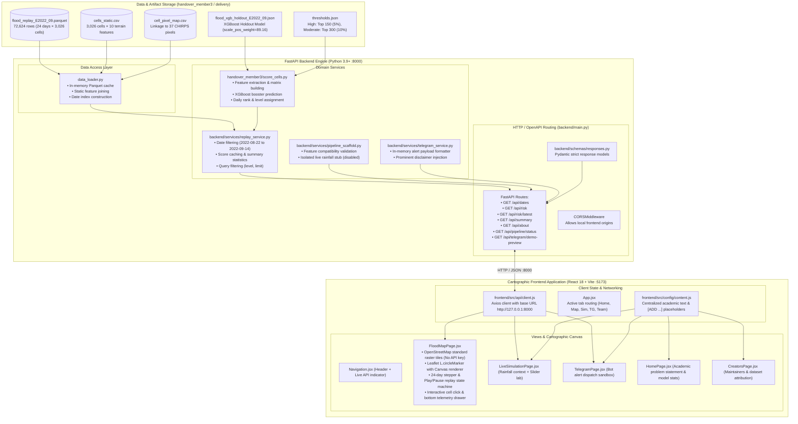
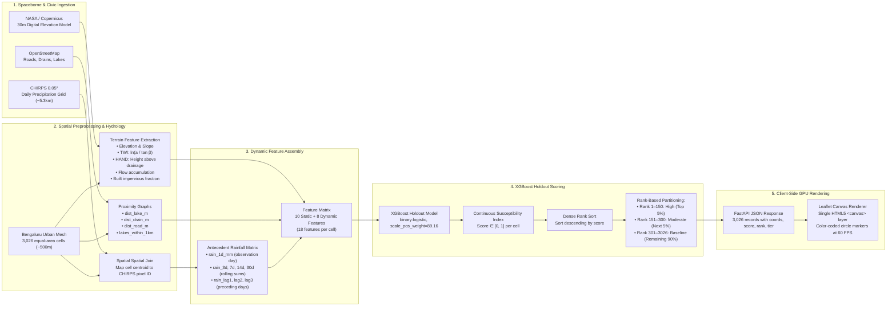
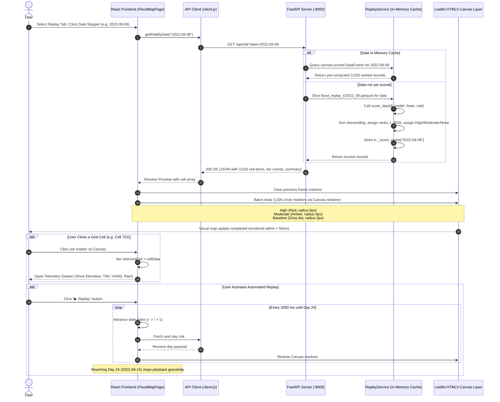

# N²M Flood Prediction Model — System Architecture

This document provides a comprehensive technical overview of the system architecture, frontend and backend implementations, in-memory data structures, scoring execution, and geospatial rendering pipelines for the **N²M Flood Prediction Model**.

---

## 1. High-Level Architectural Overview

The system is organized into a clean, decoupled three-tier topology:
1. **Data & Artifact Layer**: Pre-computed static GIS files, historical event feature archives (Apache Parquet), and trained XGBoost boosters.
2. **Backend Engine (FastAPI)**: Asynchronous REST API service providing in-memory caching, vectorized scoring, rank-based tier partitioning, and simulation scaffolding.
3. **Frontend Cartographic Interface (React 18 + Leaflet)**: Single-page application rendering an urban mesh of 3,026 spatial cells on a GPU-accelerated HTML5 Canvas with interactive historical replay controls.

---

## 2. Diagram 1: System Architecture

The following diagram illustrates the relationship between all components across the frontend, backend, and data storage layers:

---

## 3. Diagram 2: Data Flow Pipeline

The following diagram tracks the lifecycle of spatial and meteorological data, from spaceborne acquisition to client-side vector rendering:

---

## 4. Diagram 3: Historical Replay Workflow

The historical replay engine allows users to observe the evolution of flood susceptibility during the benchmark September 2022 monsoon event. The diagram below illustrates the replay cycle, state transitions, and caching:

---

## 5. Component Breakdown & Implementation Details

### 5.1 Data Access Layer (`backend/data_loader.py`)
- **Initialization**: Loads `cells_static.csv`, `cell_pixel_map.csv`, and `flood_replay_E2022_09.parquet` into RAM on application startup (`@app.on_event("startup")`).
- **Memory Footprint**: ~15 MB RAM consumed by cached DataFrames.
- **Access Pattern**: $O(1)$ dictionary lookup on partitioned date slices.

### 5.2 Replay Service (`backend/services/replay_service.py`)
- **Preserved Scoring Core**: Calls `handover_member3/score_cells.py::score_day` without altering model evaluation logic.
- **Caching Mechanism**: Maintains a dictionary `_score_cache[date_str]` storing the fully ranked Pandas DataFrame. Subsequent requests for the same date return instantly ($< 5\text{ ms}$).
- **Query Filtering**: Supports `level` (`High`, `Moderate`, `None`) and `limit` ($N \ge 1$) query parameters, executed as fast Pandas vector operations.

### 5.3 Frontend Cartography & High-FPS Canvas Renderer (`frontend/src/pages/FloodMapPage.jsx`)
- **Basemap**: OpenStreetMap standard raster tiles (`https://{s}.tile.openstreetmap.org/{z}/{x}/{y}.png`). Requires no commercial API tokens.
- **Canvas Acceleration**: Leaflet is initialized with `preferCanvas: true`. Rather than instantiating 3,026 distinct SVG `<path>` DOM elements, all markers are composited on a single HTML5 `<canvas>` context.
- **CSS Constraint Handling**: Leaflet internally relies on `L.canvas` having unrestricted dimensional padding (`padding: 0.5`). Global CSS resets containing `canvas { max-width: 100%; }` are overridden via `.leaflet-container canvas { max-width: none !important; }` to maintain accurate pixel-to-geographic coordinate transformations.
- **Replay State Machine**: Controlled via `isPlaying`, `selectedDate`, and a `useRef` timer. Autoplay evaluates `currentIndex < dates.length - 1` on each tick and halts automatically at `2022-09-14` without looping.
